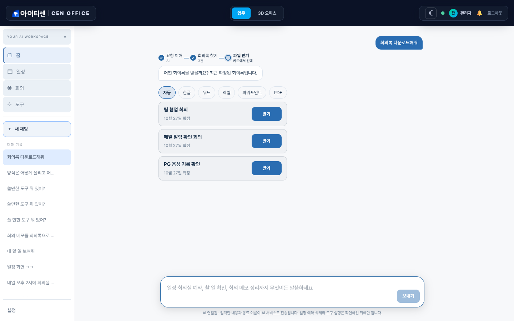
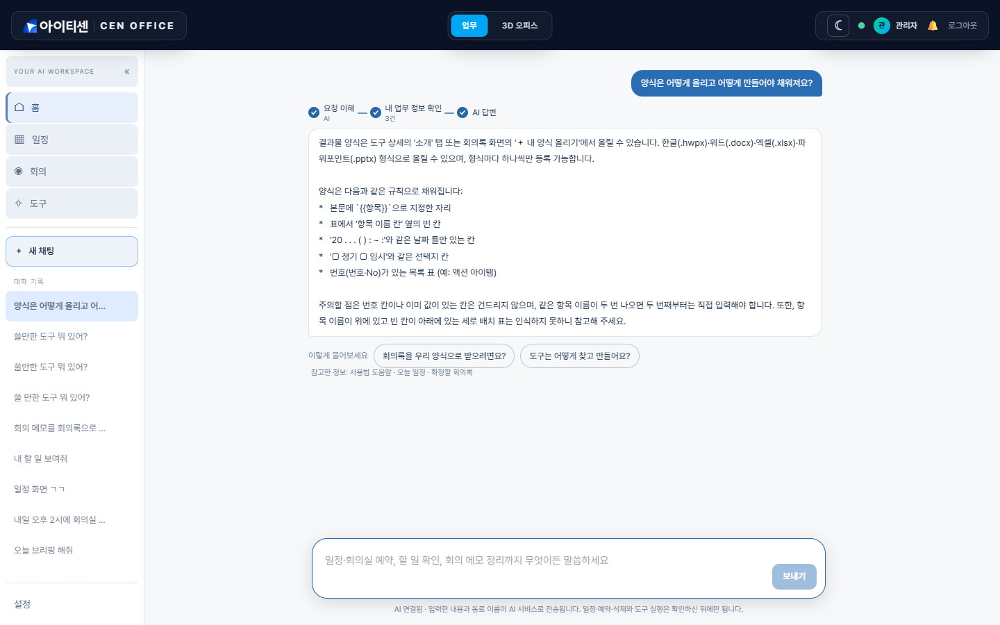
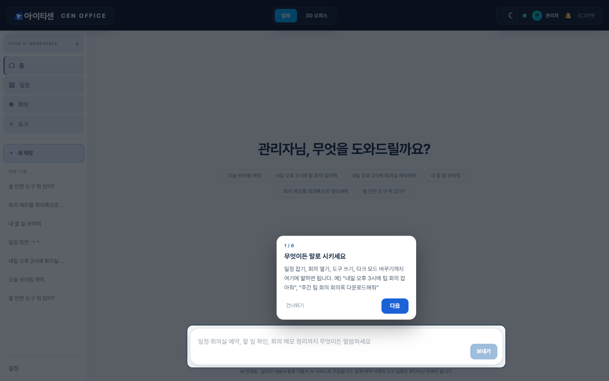
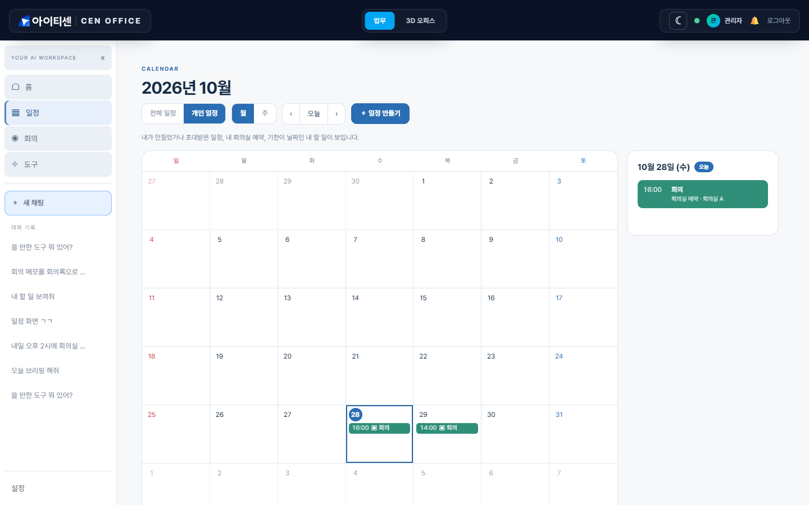
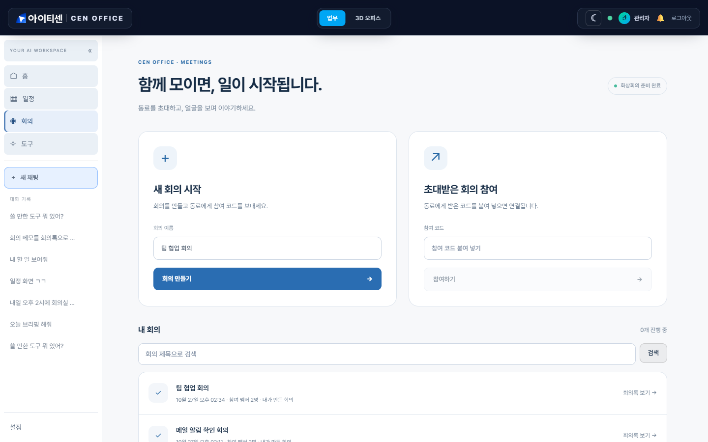
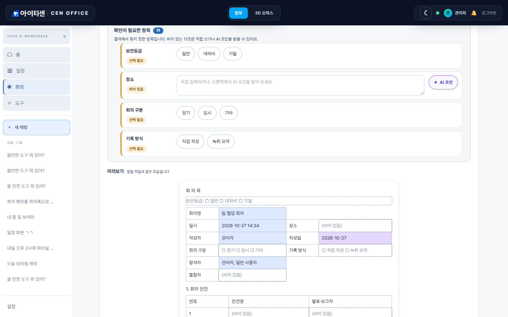
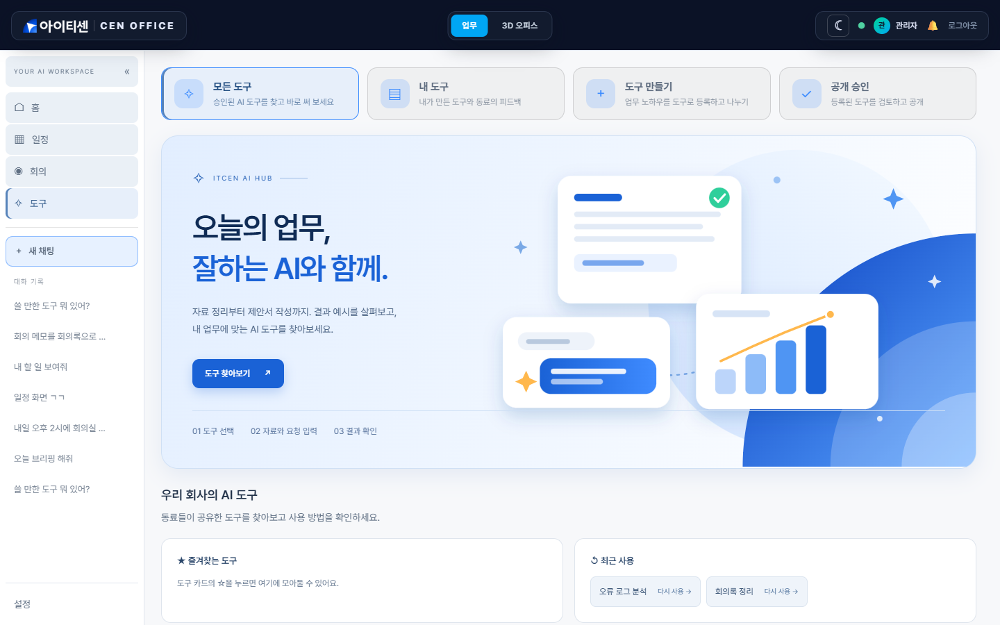
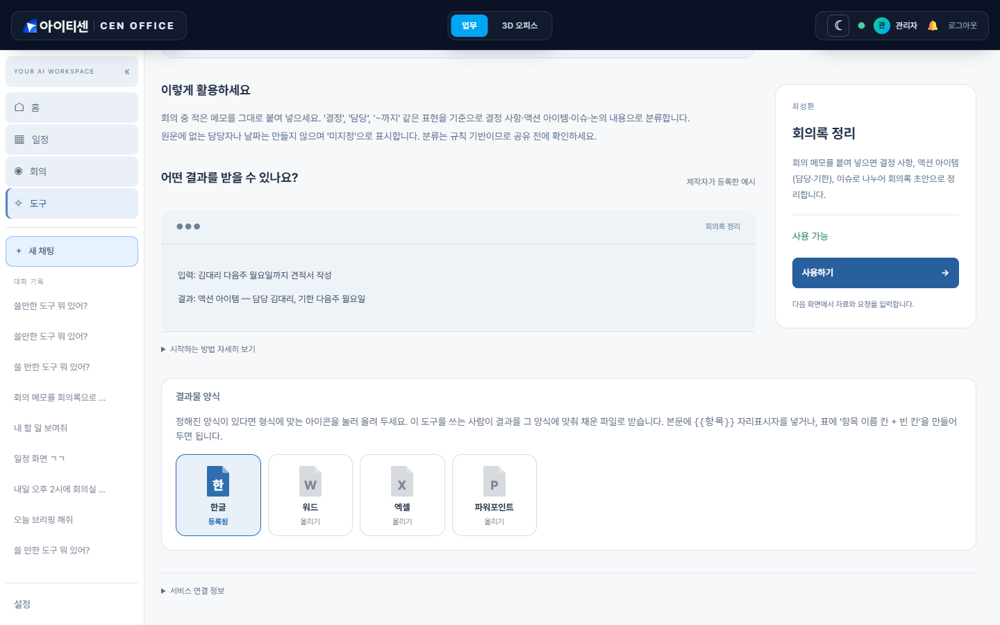
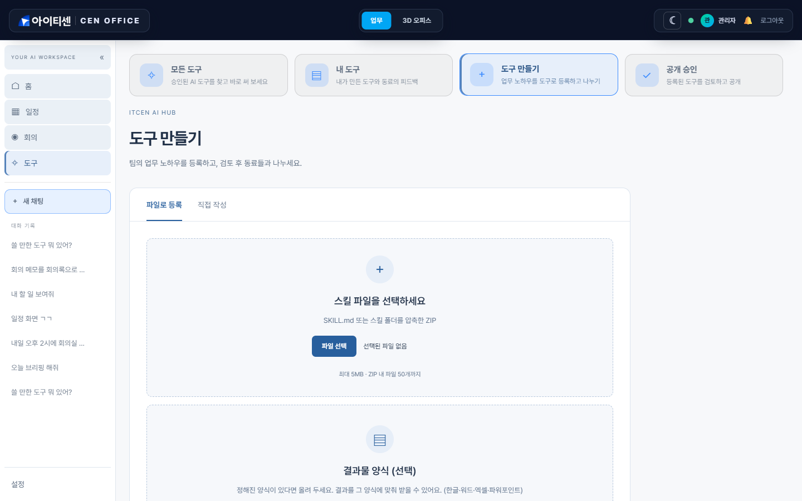
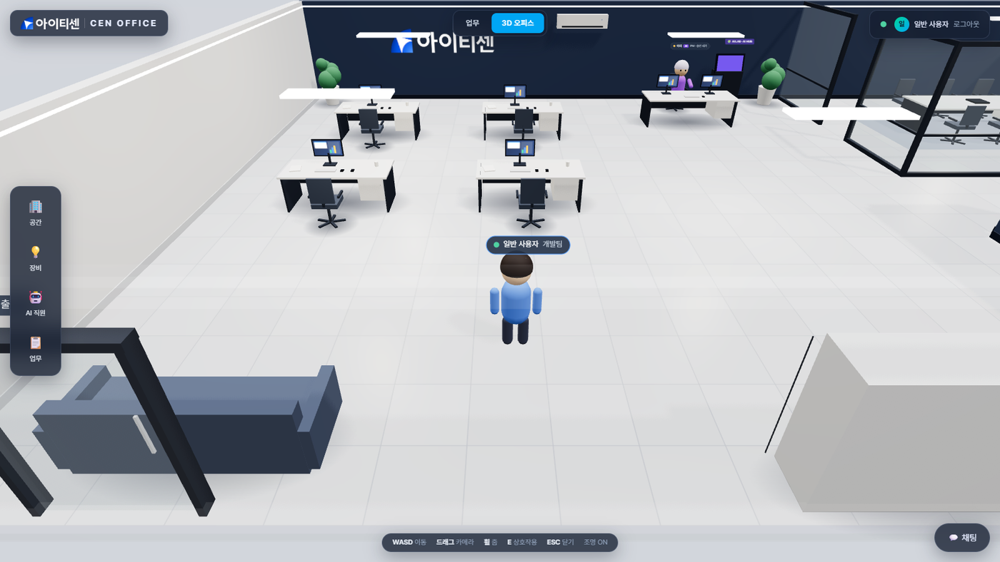

# CEN OFFICE

**말 한마디로 일정·회의·도구·문서 양식까지 처리하는 사내 AI 업무 공간.**
홈의 입력창 하나에 하고 싶은 일을 말하면, 일정 등록부터 회의록 다운로드까지 알아서 찾아 처리하고, 중요한 일은 **사람이 확인한 뒤에만** 실행합니다.



> 예: “회의록 다운로드해줘” → 확정된 회의록을 카드로 보여 주고, 형식(한글·워드·엑셀·파워포인트·PDF)을 고르면 내 양식에 맞춰 받습니다.

## 이런 프로젝트입니다

| | |
|---|---|
| **홈 입력창** | 일정·회의·도구·화면 조작을 말로 시키는 AI 어시스턴트. 사용법 질문에도 답하고, 모르면 해 볼 말을 제안 |
| **일정** | 월/주 달력, 전체(회사 공통)·개인 일정, 초대, 회의실 예약 |
| **회의 · 회의록** | 화상 회의(실제 영상·음성·화면 공유), 끝나면 회의록 요약 → 검토·확정 → 알림, 양식에 맞춰 내려받기 |
| **도구 (AI HUB)** | 직원이 만든 업무 AI 도구를 등록·승인·공유. 바로 쓸 수 있는 도구 7종 내장 |
| **결과물 양식** | 한글·워드·엑셀·파워포인트 양식을 올려 두면 결과가 그 양식에 맞춰 채워짐 |
| **3D 오피스** | 웹에서 걸어 다니는 가상 사무실(멀티플레이어, 장비·회의실 상호작용) |

## 화면으로 보기

### 홈 — 모르는 건 물어보세요
사용법 질문에는 도움말 문서를 근거로 답하고, 이어서 물어볼 만한 말을 버튼으로 보여 줍니다. 답을 기다리는 중에는 **중단** 버튼으로 멈추고 보낸 말을 고쳐 다시 보낼 수 있습니다.



### 처음 쓰는 사람을 위한 안내
처음 로그인하면 화면이 어두워지며 주요 기능을 짚어 주는 6단계 안내(코치 마크)가 나옵니다. 설정의 “사용법 다시 보기”로 언제든 다시 볼 수 있습니다.



### 일정


### 회의와 회의록


회의가 끝나면 진행자가 회의록을 만들고(채팅·음성 기록·메모를 요약), 검토해서 확정하면 참석자에게 알림이 갑니다. 확정된 회의록은 **내 양식 → 공용 양식 → 양식 없이 받기** 순으로 내려받습니다.



> 결과에서 근거를 찾은 칸은 채우고, 못 찾은 칸은 **지어내지 않고 비워 둡니다**. 비어 있는 칸은 직접 쓰거나, 선택지(□ 정기 □ 임시)는 버튼으로 고릅니다. 미리보기는 받을 파일과 같은 모습입니다.

### 도구


도구마다 **결과물 양식**을 한글·워드·엑셀·파워포인트 아이콘으로 올려 둘 수 있습니다. 올린 형식은 켜지고, 안 올린 형식은 흐리게 보입니다.



SKILL.md 파일을 올리거나 직접 작성해 등록하면 관리자 검토를 거쳐 동료에게 공개됩니다.



### 3D 오피스
상단의 `3D 오피스`로 전환합니다. 같은 사무실에 여러 명이 접속해 아바타로 움직이고, 조명·에어컨·회의실 같은 공간과 장비를 화면에서 직접 조작합니다.



## 핵심 기능

### 홈 입력창 (어시스턴트)
- **할 수 있는 일**: 일정 등록·조회·변경·삭제, 회의실 예약, 내 할 일, 오늘 브리핑, 확정 대기 회의록, 회의 시작·참여, **확정된 회의록 다운로드**, 도구 추천·실행, 화면 조작(다크 모드, 사이드바, 화면 이동, 새 채팅, 로그아웃)
- **확인 후 실행**: 일정 등록·삭제, 도구 실행처럼 되돌리기 어려운 일은 카드로 보여 주고 사용자가 누를 때만 실행합니다. 모르는 부분(어떤 회의록인지, 어떤 형식인지)은 추측하지 않고 카드로 되묻습니다.
- **AI 출력은 믿지 않음**: AI(Gemini 등)가 연결되어 있으면 말을 해석하게 하지만, 서버가 허용 목록·권한·형식을 다시 검증한 뒤에만 처리합니다. 화면 조작은 서버 허용 목록의 동작만 가능합니다. AI가 없어도 규칙 해석으로 동작합니다.
- **사용법 질문**: `backend/src/main/resources/assistant-help/` 의 도움말 문서에서 질문과 맞는 부분을 찾아 AI에게 근거로 주고, AI가 없을 때는 문서를 그대로 보여 줍니다. 도움말에 없는 내용은 지어내지 않습니다.
- **진행 단계 표시**(이해 → 확인 → 실행 …), 대화 기록은 서버에 저장(대화방), 새 채팅, 중단 버튼

### 회의와 회의록
- 화상 회의(LiveKit): 참여 코드, 장치 선택, 화면 공유, 채팅(DB 저장). 참석자가 동의하면 음성 인식 글자를 기록합니다(오디오는 저장하지 않음).
- 회의록: 진행자가 만들기 → 수정·담당자 지정 → **확정**(확정 후 수정 불가) → 참석자 알림, 담당자는 내 할 일에 추가(메일 알림은 설정 시).
- 내려받기: 홈에서 말로, 또는 회의록 화면의 “회의록 내보내기” 카드(내 양식 / 공용 양식 / 양식 없이 받기 / 내 양식 올리기).

### 결과물 양식 (한글 · 워드 · 엑셀 · 파워포인트)
- 올리는 곳: 도구 상세(만든 사람·관리자), 회의록 화면의 “내 양식”(본인만 보임). 형식마다 하나씩.
- **채워지는 자리**: 본문의 `{{항목}}`, 표의 “항목 이름 칸 + 빈 칸”, `20 . . . ( ) : ~ :` 같은 날짜 틀, `□ 정기 □ 임시` 같은 선택지 칸, 번호(번호·No)가 있는 목록 표(결정 사항·액션 아이템 등).
- **채우지 않는 것**: 번호 칸, 이미 값이 적힌 칸. 같은 이름이 두 번 나오는 항목(예: 다음 회의의 일시)의 두 번째부터는 자동으로 채우지 않고 직접 입력하게 합니다.
- **지어내지 않음**: 결과에서 근거를 못 찾은 칸은 비워 둡니다. AI 초안은 사용자가 칸마다 버튼을 눌렀을 때만 쓰고, AI가 쓴 칸은 미리보기에서 색으로 구분되며 받기 전에 한 번 더 확인합니다.
- 업로드 파일은 신뢰하지 않는 입력으로 검증합니다(크기·압축 폭탄·경로 탐색·외부 개체·너무 깊은 중첩).

### 도구 (AI HUB)
- 업로드(SKILL.md/ZIP)는 경로 탐색·심볼릭 링크·압축 폭탄·스크립트/실행 파일·API 키를 거부하는 검증을 거치고, 관리자 승인 후 공개됩니다. 도구 수정은 만든 사람과 관리자만 할 수 있습니다.
- 실행: 내장 도구 7종은 서버 안에서 규칙 기반으로 처리됩니다(외부 전송 없음). 직접 등록한 도구나 ‘AI 모델’ 선택은 `HUB_AI_ENGINE=true` 일 때 LLM으로 실행되며 **입력이 외부 서비스로 전송**됩니다(기본 꺼짐).
- 결과 내보내기: Excel · Word · PPT · PDF · 한글(HWPX) (`POST /api/hub/documents/export`). PDF는 한글 폰트가 필요합니다(`office.docs.pdf-font`).
- 외부 AI 도구 연동(API): 승인된 도구를 `GET /api/hub/skills/export.zip` 으로 내려받아 Claude Code/Codex 스킬 폴더에 설치하거나, 개인 액세스 토큰(`cen_pat_…`)으로 `POST /mcp`(MCP 서버)에 연결합니다. **지금은 이 기능의 화면이 없고 API로만 제공됩니다.**
- KPI는 실제 이벤트만 집계(시뮬레이션·샘플·제작자 본인 실행 제외)하며 점수·보상은 산정하지 않습니다.

## 바로 써 볼 수 있는 내장 도구 7종

| 도구 | 하는 일 |
|---|---|
| 오류 로그 분석 | 스택 트레이스에서 근본 원인 후보와 확인 순서 정리 |
| SQL 점검 | WHERE 없는 변경, `SELECT *` 등 위험 패턴 점검 |
| 테스트 케이스 초안 | 요구사항에서 정상·예외·경계·권한 시나리오 표 생성 |
| 회의록 정리 | 결정 사항, 액션 아이템(담당·기한), 이슈 분류 |
| 주간 업무보고 정리 | 완료·진행·예정·이슈 분류와 진행률 요약 |
| 제안서 작성 도우미 | 자료 기반 요구사항 대응표와 목차 초안 |
| FP 산정 도우미 | 기능 목록의 EI/EO/EQ 유형 후보 분류 |

내장 도구는 규칙 기반이라 정해 둔 패턴만 인식하며, 결과는 항상 ‘검토용 초안’입니다.

## 기술 구성

```
frontend/   React 19 + TypeScript + Vite + Three.js(R3F) + Zustand + Tailwind, LiveKit client
backend/    Spring Boot 3 / Java 21 / JPA + JdbcTemplate / Flyway / WebSocket / JWT / LiveKit server SDK
scripts/    run-backend.ps1, start-local.ps1, setup-postgres.ps1, setup-mail.ps1, 화상회의 시연 스크립트
assets/     README 이미지
.tools/     (선택) 로컬 JDK 21 + Maven — git 제외
```

---

# 개발자 문서

## 실행

### 가장 쉬운 방법 (Windows)
`start-local.bat` 을 더블클릭하면 백엔드(8080)와 프론트엔드(5180)를 띄우고 준비되면 브라우저를 엽니다. 종료는 `stop-local.bat`. (JDK 21·Node.js 필요, 처음 한 번은 의존성 설치로 시간이 걸립니다.)

### 직접 실행

#### 1) 백엔드 (포트 8080)
```powershell
.\scripts\run-backend.ps1
```
- `.tools\` 의 JDK 21/Maven 이 있으면 사용하고, 없으면 시스템 `java`(21+)/`mvn` 을 사용합니다.
- `OFFICE_ADMIN_PASSWORD`, `OFFICE_USER_PASSWORD` 환경변수가 없으면 최초 1회 임의 생성되어 `backend\.local-credentials.txt`(git 제외)에 저장됩니다. 계정: `admin`(관리자), `user`(일반). 이 파일에 `LLM_PROVIDER`, `GEMINI_API_KEY` 같은 줄을 넣으면 스크립트가 읽습니다.
- 기본 DB는 로컬 파일 H2(PostgreSQL 호환 모드, `backend/data/`)라서 별도 설치 없이 실행됩니다. PostgreSQL을 쓰려면 `scripts\setup-postgres.ps1` 로 DB·계정을 만들면 `run-backend.ps1` 이 자동으로 사용합니다.
- 직접 실행: `cd backend && mvn spring-boot:run`

#### 2) 프론트엔드 (포트 5180)
```bash
cd frontend
npm install
npm run dev
```
접속하면 기본 화면은 **업무(WORKSPACE)** 홈이고 로그인 창이 뜹니다. 상단에서 `업무` / `3D 오피스` 를 전환합니다. 로그인 창의 **“로컬 모드로 둘러보기”** 를 누르면 백엔드 없이도 3D 사무실·조명·Mock AI는 동작합니다.

#### 테스트
```bash
cd backend
mvn test        # 270개 (2026-10-29 기준 전부 통과)
cd ../frontend
npx tsc --noEmit -p . && npx vite build
```

## 환경변수

| 변수 | 설명 | 기본값 |
|---|---|---|
| `DB_URL` / `DB_USER` / `DB_PASSWORD` | PostgreSQL 사용 시 지정 (예: `jdbc:postgresql://localhost:5432/cenoffice`) | 파일 H2 |
| `JWT_SECRET` | JWT 서명키(32자 이상). 비우면 기동 시 임의 생성(재시작 시 로그인 만료) | 임의 |
| `JWT_TTL_MINUTES` | 토큰 유효 시간 | 480 |
| `OFFICE_ADMIN_PASSWORD`, `OFFICE_USER_PASSWORD` | 시드 계정 비밀번호 | 임의 생성 |
| `CORS_ORIGINS` | 허용 프론트 주소 | `http://localhost:5180` |
| `DEVICE_COMMAND_TIMEOUT_SECONDS` | 장비 응답 대기 한도 | 10 |
| `MOCK_MIN_LATENCY_MS` / `MOCK_MAX_LATENCY_MS` / `MOCK_FAILURE_RATE` | Mock 장비 지연/실패율(실패 처리 테스트용) | 300/900/0.0 |
| `HUB_AI_ENGINE` | 도구의 AI 모델 실행 허용(입력이 LLM 서비스로 전송됨) | false (개발 스크립트는 true) |
| `HUB_RUNTIME` | 도구 실행 런타임: `none` / `mock`(테스트용·KPI 제외) / `llm` | none |
| `HUB_SEED_SAMPLES` | 동작하지 않는 예시(샘플) 도구를 등록할지 | false |
| `LLM_PROVIDER` / `GEMINI_API_KEY` 등 | 도구·홈 입력창·회의 AI의 LLM (키는 코드·저장소에 넣지 말고 로컬 설정으로) | mock |
| `MAIL_HOST` / `MAIL_USERNAME` 등, `APP_BASE_URL` | 회의록 확정·할 일 알림 메일(비우면 화면 알림만) | 비어 있음 |
| `VITE_API_URL` (프론트) | 백엔드 주소 | `http://localhost:8080` |

## 3D 오피스 조작

| 입력 | 동작 |
|---|---|
| W / S | 바라보는 방향으로 전진 / 후진 |
| A / D | 시점(카메라+캐릭터) 좌우 회전 (`Player.tsx`의 `TURN_MODE=false`면 좌우 평행이동) |
| 마우스 드래그 / 휠 | 카메라 회전 / 줌 |
| E | 가까운 오브젝트 상호작용 (조명 스위치, 에어컨, 서버실, 회의실, AI 직원 …) |
| ESC | 패널 닫기 |

## 구현 현황

**구현됨**
- 홈 입력창: 규칙 해석 + AI 해석(서버 재검증), 일정·회의실 예약·할 일·브리핑·회의 시작/참여·회의록 다운로드·도구 실행·화면 조작, 대화방 서버 저장, 진행 단계 표시, 중단, 사용법 도움말 답변
- 일정(월/주, 전체/개인, 초대, 회의실 예약), 알림(화면 + 선택적 메일)
- 화상 회의(LiveKit), 회의 채팅·음성 인식 글자 기록(참석자 동의), 회의록 생성·확정·내보내기
- 결과물 양식: 한글·워드·엑셀·파워포인트, 빈 칸·자리표시자·선택지·날짜 틀·목록 표, 내 양식/공용 양식
- 도구(AI HUB): 등록·승인·공개·평가·즐겨찾기, 내장 7종, 결과 내보내기 5형식
- 첫 사용 안내(코치 마크), 다크/라이트 모드, 좁은 화면(1024px 미만)에서 위쪽 탭 메뉴로 전환
- 3D 사무실, 멀티플레이어, 장비 관리(조명·에어컨·회의실 예약·서버실 패널), JWT 로그인(ADMIN/USER), 감사 로그
- DB는 Flyway(`V1`~`V13`)로 관리

**아직 아닌 것 / 한계 (정직하게)**
- 양식: 항목 이름이 위, 빈 칸이 아래인 **세로 배치 표는 읽지 못합니다**. 값 안의 줄바꿈은 공백으로 합쳐집니다. 목록 표는 양식에 있는 줄 수까지만 채웁니다. 옛 `.hwp` 는 지원하지 않습니다(`.hwpx` 로 저장). 실제 한글·워드·엑셀·파워포인트 프로그램에서 열어 확인한 것은 일부이며 대부분은 자동 테스트와 미리보기로 검증했습니다.
- 회의록: 삭제 기능이 없습니다. 요약은 항상 정해진 틀(요약·결정·액션·이슈)로 나오므로, 양식에만 있는 항목(안건·장소 등)은 비어 있습니다.
- 홈 입력창은 정해 둔 자료(내 일정·할 일·도구·도움말)만 근거로 답하며, 못 답한 질문을 모아 보는 기능은 없습니다.
- 외부 AI 도구 연동(스킬 내려받기·MCP)은 API만 있고 화면이 없습니다. 프로젝트·요구사항·AI PM 기능은 사용하지 않아 제거했습니다.
- 음성 기록은 브라우저의 음성 인식 기능을 쓰므로, 브라우저에 따라 음성이 제공사 서버로 전송될 수 있습니다.
- 서버 모니터링 데이터는 **Mock**입니다. `MqttDeviceAdapter` / `HttpDeviceAdapter` 는 미구현(해당 타입 장비에 명령하면 FAILED). AI 직원(3D 채팅)은 Mock입니다.
- 스키마는 Flyway와 함께 `ddl-auto=update` 도 켜져 있어, 운영 전에 정리가 필요합니다. 예약 중복 방지는 SERIALIZABLE 트랜잭션 기반이며 단일 인스턴스를 가정합니다.
- 푸시·운영 배포·사내망·실제 카메라/마이크 품질 검증은 별도입니다.

## 환경 경계 (장비 명령)

- 장비 명령 상태는 `REQUESTED → SENT → CONFIRMED / FAILED / TIMEOUT` 이며 **장비가 확인(보고)한 값만 화면/DB 상태에 반영**합니다(전송했다는 이유로 성공 처리하지 않음).

## LLM 연결

- **LLM Provider 는 인터페이스**(`LlmProvider`, 패키지 `llm`)로 분리: `MockLlmProvider`(기본, 규칙 기반) / `GeminiLlmProvider` / `AnthropicLlmProvider` / `OpenAiLlmProvider`. 실제 LLM 은 `LLM_PROVIDER=gemini` + `GEMINI_API_KEY`(모델 `GEMINI_MODEL`, 기본 gemini-2.5-flash), `anthropic` + `ANTHROPIC_API_KEY`, `openai` + `OPENAI_API_KEY`(`OPENAI_MODEL`, 기본 gpt-4o-mini) 환경변수가 있을 때만 사용되며, **입력 원문이 외부 서비스로 전송**됩니다. 키가 없으면 자동으로 Mock.
- **AI 출력은 신뢰하지 않음**: 홈 입력창·양식 채우기·회의 AI 모두 AI가 돌려준 값을 서버가 다시 검증한 뒤에만 사용하고, 실제 변경은 사람이 확인해야 실행됩니다.
- Gemini 는 실제 키로 검증했습니다. Anthropic/OpenAI 는 유효한 키로 성공 호출을 검증하지 못했습니다.

## 멀티플레이어 / 채팅 (3D 오피스)

- 같은 `/ws` 연결로 접속자·위치를 동기화합니다. 클라이언트가 보낼 수 있는 메시지는 `pos`(위치)와 `hb`(생존 신호)뿐이고, **사용자 신원은 항상 JWT 에서만** 가져옵니다.
- 위치는 서버 메모리에만 저장하고 100ms 단위로 변경분만 방송합니다. 범위·이동 속도 검증을 통과하지 못한 값은 버립니다.
- 15초 동안 신호가 없으면 접속 종료로 처리합니다. 같은 계정으로 다시 접속하면 **새 접속이 우선**이며 이전 연결은 코드 4001 로 종료됩니다.
- 채팅: 전체 / 1:1 / AI(아리). 메시지는 DB 에 저장되고, 1:1·AI 대화는 참여자만 조회·전송·수신할 수 있으며(서버가 매 요청 확인) 500자·5초당 5건 제한이 있습니다. 화면에는 항상 **텍스트로만** 출력합니다.

## 보안/안정성

- 감사 로그는 호출 트랜잭션이 롤백돼도 남도록 별도 트랜잭션으로 저장합니다. 홈 입력창의 입력 문장은 민감할 수 있어 감사 로그에 기록하지 않습니다.
- 로그인 실패 5회(계정+IP) / IP당 20회 → 10분 잠금(429), 메모리 기반(단일 인스턴스).
- 같은 장비에 처리 중인 명령이 있으면 새 명령 거부(409). 권한 거부(ACCESS_DENIED), 로그인 잠금이 감사 로그에 기록됩니다.
- WebSocket: 토큰 필수, 만료 시 연결 종료, 클라이언트 메시지는 거부(1008). 이벤트는 인증된 전원에게 방송됩니다(사용자별 구독 제한 없음).
- 결과물 양식 업로드: 크기(5MB)·압축 해제 크기·항목 수·필드 수 제한, 경로 탐색 거부, XML 외부 개체/DTD 거부, 중첩 깊이 제한. 내 양식은 본인만 접근하며 관리자도 남의 양식은 볼 수 없습니다.
- 알려진 한계: JWT 는 발급 후 사용자 삭제·권한 변경이 만료 전까지 반영되지 않음.

## 로컬 화상회의 시연

사내 LLM 없이 **실제 LiveKit 영상·음성·화면 공유**를 사용합니다. 기본 업무 DB와 분리된 시연 DB를 사용하며, 한 PC에서 Chrome과 Edge로 시연하는 구성입니다.

```powershell
# 최초 1회: 공식 Windows LiveKit 바이너리 다운로드 + SHA256 검증
powershell -NoProfile -ExecutionPolicy Bypass -File .\scripts\setup-meeting-media.ps1
# 프론트 패키지가 아직 없으면: cd frontend; npm install
# 실행: 백엔드 빌드 후 세 서버를 숨김 창으로 기동
powershell -NoProfile -ExecutionPolicy Bypass -File .\scripts\start-meeting-demo.ps1
# 종료: 이 스크립트가 기록한 시연 프로세스만 종료
powershell -NoProfile -ExecutionPolicy Bypass -File .\scripts\stop-meeting-demo.ps1
```

- 화면: **http://localhost:5174** / API: 8090 / LiveKit: 7880, RTC TCP 7881·UDP 7882. 모두 로컬 전용입니다.
- 계정: Chrome은 `admin`, Edge는 `user`. 임의 생성된 비밀번호는 `backend/.local-credentials-meeting.txt`에서 확인합니다.
- 데이터: `backend/data/meeting-demo.mv.db`. LiveKit 키는 시작 스크립트가 `backend/.meeting-local.properties`에 생성합니다. 키/계정/DB/로그는 Git에 포함되지 않습니다.
- `LLM_PROVIDER=mock`, `HUB_AI_ENGINE=false` 로 실행하므로 외부 LLM 호출이 필요하지 않습니다.

**3분 시연 순서**

1. 두 브라우저에서 서로 다른 계정으로 로그인 → 왼쪽 **회의**.
2. 첫 브라우저에서 회의 이름 입력 → **회의 만들기** → 장치 선택 → **회의 참여하기**.
3. 통화 화면 오른쪽 위 **동료 초대**로 코드를 복사합니다.
4. 두 번째 브라우저에서 코드 붙여 넣기 → 참여. 한 PC에서는 소리 울림을 막기 위해 한쪽 마이크를 끄고 헤드폰을 사용하세요.
5. 화면 공유, 메시지 전송, 카메라/마이크 전환을 시연합니다. 호스트가 **전체 종료**를 누르면 양쪽이 퇴장합니다.
6. 회의가 끝나면 **회의록 만들기 → 확정 → 내보내기**까지 이어서 시연할 수 있습니다.

**제약:** 이 시연은 로컬 전용입니다. 여러 PC 접속은 HTTPS·내부망 주소·TURN 등을 별도로 구성해야 합니다. Windows LiveKit은 CPU 용량 감시가 비활성화되는 경고가 있으므로 운영 수용량 검증에 사용하지 않습니다. 기본 실행에는 AI 참가자가 없으며 아래 `-WithAi` 실행에서 센을 사용할 수 있습니다. 회의 오디오는 녹음하지 않습니다(음성 기록은 글자만).

**보안 경계:** 코드를 아는 로그인 사용자가 참여하는 초대 방식입니다. 엄격한 지정 참석자 승인·강퇴는 후속 범위입니다. 입장 토큰은 30초, 회원 확인 후 서버에서 발급하며 호스트 종료 시 LiveKit room도 삭제합니다. 이미 발급된 토큰의 즉시 폐기는 보장하지 않으므로 전사 운영 전 재입장 통제를 보강해야 합니다.

재현 스크립트는 `scripts/test-meeting-demo.cjs`이며 Playwright와 두 브라우저가 필요합니다(`PLAYWRIGHT_MODULE` 환경변수로 Playwright 모듈 경로 지정 가능).

## 회의 AI 센 — 버튼으로 음성 질문하기

```powershell
powershell -NoProfile -ExecutionPolicy Bypass -File .\scripts\start-meeting-demo.ps1 -WithAi
```

- `GEMINI_API_KEY`를 환경변수 또는 기존 git 제외 파일 `backend/.local-credentials.txt`에 설정합니다. `-WithAi` 없이 실행하면 기존 모의 AI 설정을 유지합니다. 이미 실행 중인 시연은 `stop-meeting-demo.ps1`로 종료 후 다시 실행합니다.
- 회의 진행자가 오른쪽 **AI 센** 탭 → **AI 센 켜기** → **센에게 질문** → 말하기 → **질문 완료**. 회의 대화 맥락을 참고하려면 참석자가 하단 **음성 기록**도 켜야 합니다. 글로 입력하고 **질문 보내기**도 가능합니다. 모든 참석자가 **말 멈추기**를 사용할 수 있고, 다른 탭에서도 답변 중단 버튼이 표시됩니다. 기록과 AI 답변은 각 탭 안에서 스크롤됩니다.
- 브라우저 STT로 질문을 받고 실제 LLM이 현재 음성 기록 동의자의 최근 40개 발언을 참고합니다. 질문과 답변 글은 저장됩니다. Gemini TTS는 답변 텍스트만 받습니다. 회의 원본 오디오는 앱 서버에 저장하지 않습니다.
- 질문한 브라우저가 별도 LiveKit 참가자 **센 (AI)**으로 합성 음성을 송출하므로 원격 참석자도 같은 음성을 듣습니다. 질문자 브라우저를 닫으면 음성도 종료됩니다. 답변 중에는 음성 인식을 잠시 멈춥니다. 대면 회의는 회의용 PC 한 대의 마이크/스피커로 사용하세요.
- `MEETING_AI_ENABLED=true`, `LLM_PROVIDER=gemini`로 활성화합니다. TTS 기본 모델은 `gemini-3.8-flash-lite-tts`, 목소리는 `Kore`이며 `MEETING_TTS_MODEL`, `MEETING_TTS_VOICE`로 변경합니다. 모델 접근·쿼터는 계정별 실제 호출로 확인해야 합니다.
- 합성 음성은 메모리에만 임시 보관하고 완료/중단/만료 시 비웁니다. 회의 활성화 상태도 서버 재시작 시 꺼집니다. 단일 서버 시연용이며 호출어 자동 감지·말 끼어들기·사내 음성 엔진은 후속 범위입니다. 사내 전환 시 `SpeechSynthesizer`, `LlmProvider`, STT 훅을 교체합니다.
- 재현: `PLAYWRIGHT_MODULE`을 Playwright 패키지 경로로 지정하고 `node scripts/test-meeting-assistant.cjs`. 합성 STT 이벤트를 사용하며 실제 LiveKit RTP 수신과 중단을 검사합니다. `-WithAi` 시 실제 API 사용료가 발생할 수 있습니다.
- 검증(2026-10-28): 백엔드 전체 294개 테스트와 프론트 빌드 통과. Chrome/Edge에서 실제 Gemini 답변·TTS, 양쪽 AI 음성 수신, 참석자 중단, 답변 자연 종료 후 다음 질문을 검증했습니다. 첫 오디오 수신 약 15~18초. 마이크 인식 결과는 재현용 합성 이벤트이므로 실물 마이크/회의실 음향은 현장 확인이 필요합니다.

## 설계 메모
- AI는 **제안**만 하고, 일정 등록·삭제·도구 실행·파일 받기 같은 실제 변경은 사람이 확인한 뒤에만 합니다.
- 근거가 없는 값은 **지어내지 않고 비워 둡니다**(양식 채우기, 도움말 답변 모두).
- 충돌은 `@react-three/rapier` 대신 경량 자체 구현(`frontend/src/game/collision.ts`)을 사용합니다.
- 색상/조명/상태색은 `frontend/src/theme.ts` 한 곳에서 관리합니다. 3D 오브젝트 ↔ 장비 매핑: `Device.objectId` = 프론트 `layout.ts` 의 interactable id.
- 홈 입력창 도움말을 늘리려면 `backend/src/main/resources/assistant-help/*.md` 에 문서를 추가합니다(첫 줄 `# 제목`, `질문:`, `키워드:`, 빈 줄, 본문).
