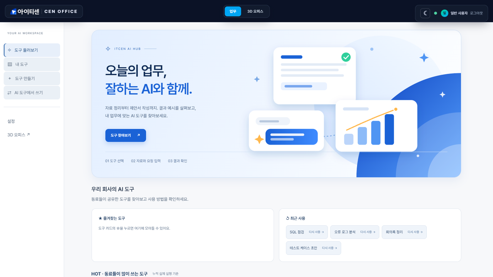
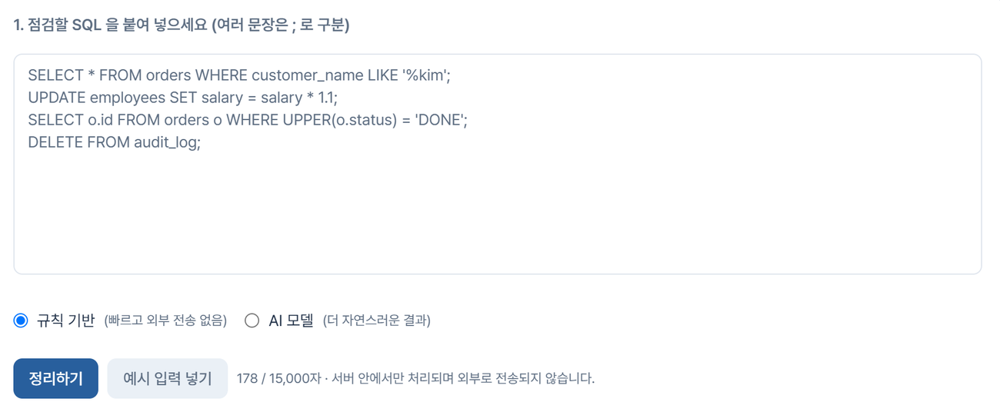
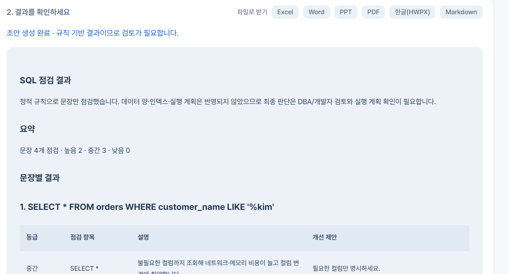
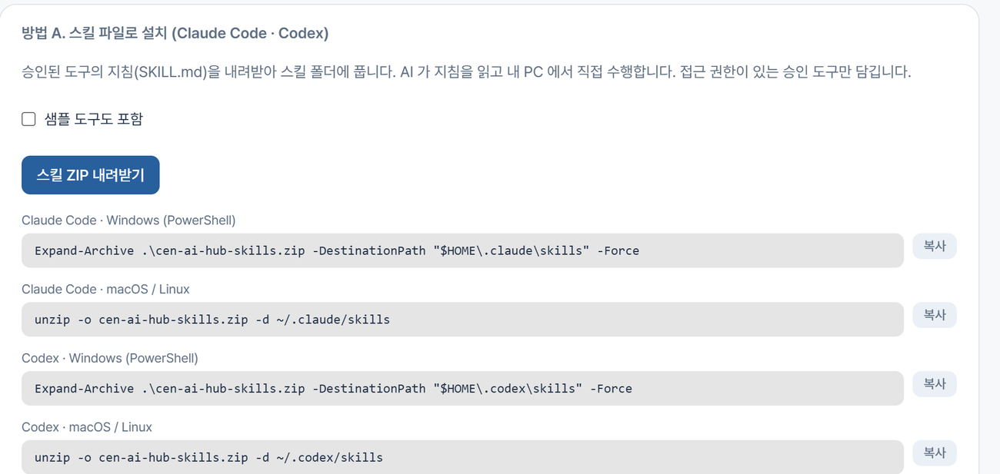

# CEN OFFICE

**웹에서 일하는 3D AI 스마트 오피스.**
브라우저로 접속해 가상 사무실을 걸어 다니며 동료와 대화하고, 사내 AI 도구를 골라 바로 쓰는 업무 플랫폼입니다.


> 같은 사무실에 여러 명이 동시에 접속해 아바타로 움직이고, 실시간으로 채팅합니다. 조명·에어컨·회의실 같은 공간과 장비는 화면에서 직접 조작합니다.

## 이런 프로젝트입니다

| | |
|---|---|
| **3D 오피스** | 웹에서 걸어 다니는 가상 사무실. 멀티플레이어, 전체/1:1/AI 채팅, 장비·회의실 상호작용 |
| **WORKSPACE** | 프로젝트·요구사항·작업 관리. 역할(관리자/일반)에 따른 권한 |
| **AI PM '아리'** | 요구사항을 분석해 작업 계획 초안을 만들고, **사람이 승인한 뒤에만** 등록 |
| **AI HUB** | 직원이 만든 업무 AI 도구를 등록·승인·공유하는 사내 허브. 바로 쓸 수 있는 도구 7종 내장 |

## 화면으로 보기

### AI HUB — 우리 회사의 AI 도구 모음


### 붙여 넣고 누르면 끝
SQL, 오류 로그, 회의 메모, 요구사항 등을 붙여 넣으면 결과가 표로 정리됩니다. 처리 방식은 규칙 기반(외부 전송 없음)과 AI 모델 중에서 고릅니다.




결과는 **Excel · Word · PPT · PDF · 한글(HWPX)** 파일로 바로 받을 수 있습니다.

### 내 AI 도구(Claude Code, Codex 등)에서 그대로 쓰기
승인된 도구를 스킬 파일(SKILL.md)로 내려받아 설치하거나, MCP 서버로 연결해 서버의 도구를 직접 호출합니다.



### 도구 만들기 — 업무 노하우를 도구로
SKILL.md 파일을 올리거나 직접 작성해 등록하면 관리자 검토를 거쳐 동료에게 공개됩니다.


## 바로 써 볼 수 있는 내장 도구 7종

| 도구 | 하는 일 |
|---|---|
| 오류 로그 분석 | 스택 트레이스에서 근본 원인 후보와 확인 순서 정리 |
| SQL 점검 | WHERE 없는 변경, `SELECT *` 등 위험 패턴 점검 |
| 테스트 케이스 초안 | 요구사항에서 정상·예외·경계·권한 시나리오 표 생성 |
| 회의록 정리 | 결정 사항, 액션 아이템(담당·기한), 이슈 분류 |
| 주간 업무보고 정리 | 완료·진행·예정·이슈 분류와 진행률 요약 |
| 제안서 작성 도우미 | 자료 기반 요구사항 대응표와 목차 초안 |
| FP 산정 도우미 | 기능 목록의 EI/EO/EQ 유형 후보 분류 |

내장 도구는 규칙 기반이라 정해 둔 패턴만 인식하며, 결과는 항상 '검토용 초안'입니다.

## 기술 구성

```
frontend/   React + TypeScript + Three.js(R3F) + Zustand + Tailwind
backend/    Spring Boot 3 / Java 21 / JPA / Flyway / WebSocket / JWT
scripts/    run-backend.ps1  (Windows 백엔드 실행 스크립트)
.tools/     (선택) 로컬 JDK 21 + Maven — git 제외
```

---

# 개발자 문서

## 실행

### 가장 쉬운 방법 (Windows)
`start-local.bat` 을 더블클릭하면 백엔드(8080)와 프론트엔드(5180)를 띄우고 준비되면 브라우저를 엽니다. 종료는 `stop-local.bat`. (JDK 21·Node.js 필요, 처음 한 번은 의존성 설치로 시간이 걸립니다.)

### 직접 실행

### 1) 백엔드 (포트 8080)
```powershell
.\scripts\run-backend.ps1
```
- `.tools\` 의 JDK 21/Maven 이 있으면 사용하고, 없으면 시스템 `java`(21+)/`mvn` 을 사용합니다.
- `OFFICE_ADMIN_PASSWORD`, `OFFICE_USER_PASSWORD` 환경변수가 없으면 최초 1회 임의 생성되어 `backend\.local-credentials.txt`(git 제외)에 저장됩니다. 계정: `admin`(관리자), `user`(일반).
- 기본 DB는 로컬 파일 H2(PostgreSQL 호환 모드, `backend/data/`)라서 별도 설치 없이 실행됩니다.

직접 실행하려면: `cd backend && mvn spring-boot:run`, 테스트: `mvn test`

### 2) 프론트엔드 (포트 5180)
```bash
cd frontend
npm install
npm run dev
```
접속하면 기본 화면은 **WORKSPACE** 이고 로그인 창이 뜹니다. 상단에서 `WORKSPACE` / `3D OFFICE` 를 전환합니다. **"로컬 모드로 둘러보기"** 를 누르면 백엔드 없이도 3D 사무실·조명·Mock AI는 동작합니다.

## 환경변수

| 변수 | 설명 | 기본값 |
|---|---|---|
| `DB_URL` / `DB_USER` / `DB_PASSWORD` | PostgreSQL 사용 시 지정 (예: `jdbc:postgresql://localhost:5432/cenoffice`) | 파일 H2 |
| `JWT_SECRET` | JWT 서명키(32자 이상). 비우면 기동 시 임의 생성(재시작 시 로그인 만료) | 임의 |
| `JWT_TTL_MINUTES` | 토큰 유효 시간 | 480 |
| `OFFICE_ADMIN_PASSWORD`, `OFFICE_USER_PASSWORD` | 시드 계정 비밀번호 | 임의 생성 |
| `CORS_ORIGINS` | 허용 프론트 주소 | `http://localhost:5180` |
| `DEVICE_COMMAND_TIMEOUT_SECONDS` | 장비 응답 대기 한도 | 10 |
| `MOCK_MIN_LATENCY_MS` / `MOCK_MAX_LATENCY_MS` / `MOCK_FAILURE_RATE` | Mock 장비 지연/실패율(실패 처리 테스트용) | 300/900/0.0 |
| `HUB_AI_ENGINE` | AI HUB 의 AI 모델 실행 허용(입력이 LLM 서비스로 전송됨) | false (개발 스크립트는 true) |
| `LLM_PROVIDER` / `GEMINI_API_KEY` 등 | AI PM·AI HUB 의 LLM (키는 코드·저장소에 넣지 말고 로컬 설정으로) | mock |
| `VITE_API_URL` (프론트) | 백엔드 주소 | `http://localhost:8080` |

## 조작

| 입력 | 동작 |
|---|---|
| W / S | 바라보는 방향으로 전진 / 후진 |
| A / D | 시점(카메라+캐릭터) 좌우 회전 (`Player.tsx`의 `TURN_MODE=false`면 좌우 평행이동) |
| 마우스 드래그 / 휠 | 카메라 회전 / 줌 |
| E | 가까운 오브젝트 상호작용 (조명 스위치, 에어컨, 서버실, 회의실, AI 직원 …) |
| ESC | 패널 닫기 |

## 구현 현황

**구현됨**
- 3D 사무실, 캐릭터 이동/충돌/카메라, 벽 투명화, 조명 ON/OFF (Phase 1)
- JWT 로그인(ADMIN/USER 권한), REST API, WebSocket 실시간 이벤트(`device.state`, `command.update`, `reservation.changed`)
- 장비 관리: 명령 상태 `REQUESTED → SENT → CONFIRMED / FAILED / TIMEOUT`.
  **장비가 확인(보고)한 값만 화면/DB 상태에 반영**하며, 전송했다는 이유로 성공 처리하지 않음. 응답 없으면 TIMEOUT.
- `DeviceAdapter` 인터페이스 + `MockDeviceAdapter`(지연·실패·에어컨 온도 변화 시뮬레이션)
- 조명 / 에어컨(전원·목표온도·냉난방·현재온도) / 회의실 예약(조회·생성·취소·중복 방지) / 서버실 모니터링 패널
- 감사 로그(로그인, 장비 명령, 예약), 시작 시 장비 실제 상태 동기화
- AI 직원의 조명 제어는 사용자 승인 후 같은 명령 파이프라인을 사용 (온라인이면 장비 확인까지 대기)
- 백엔드 테스트 4건 (인증, 장비 명령 확정 흐름, 잘못된 명령 거부, 예약 중복)

**아직 아닌 것 (정직하게)**
- 서버 모니터링 데이터는 **Mock**입니다 (`ServerMonitor` 인터페이스만 분리됨).
- `MqttDeviceAdapter` / `HttpDeviceAdapter` 는 미구현 → Phase 4. 해당 타입 장비에 명령하면 FAILED 처리됩니다.
- 엔티티 `Office / Space / OfficeObject / AiAgent / AiTask / AiTaskExecution` 은 아직 없음 (Device.objectId 로 3D 매핑만 제공). 개인 책상 업무 대시보드는 Phase 3.
- AI 직원은 여전히 Mock(LLM/Tool Calling 미연동, 업무 기록 미저장) → Phase 3.
- PostgreSQL 은 이 PC에 없어 실제 접속 테스트는 못 했습니다(H2 PostgreSQL 모드로만 검증). 스키마는 `ddl-auto=update` 입니다.
- 예약 시간 중복 방지는 SERIALIZABLE 트랜잭션 기반이며 단일 인스턴스를 가정합니다.
- 로그인 시도 횟수 제한(rate limit)은 아직 없습니다.

## Phase 3A (WORKSPACE)

- 메뉴: Home · Projects · Requirements · AI Agents(Mock) · Development/Testing/Deployment(준비 중) · Monitoring(Mock) · Office Management · Settings
- 엔티티/API: Project, Requirement, ProjectTask, AiAgent, AiTask, AgentExecution, ApprovalRequest (CRUD, 작업 담당 AI 지정, 작업/요구사항 이력 = 감사 로그 기반, 승인 요청/결정)
- **환경 경계(서버 강제)**: DEV 읽기·테스트·개발 / STG 읽기·테스트 / PROD 읽기 전용이며 **어떤 AI 에이전트에도 PROD 권한 없음**. 배포(DEPLOY) 권한과 운영 배포 실행 기능은 존재하지 않음.
- 승인: 요청자 본인은 승인 불가(관리자 제외), 이미 처리된 요청은 재처리 불가.
- AI 작업 자동 실행은 **AI PM 요구사항 분석(DRAFT_SPEC)만** 지원합니다. 그 외 유형은 접수(QUEUED)·승인 기록까지만 저장됩니다.

## AI HUB (Skill / Agent 허브)

직원이 만든 AI Skill(SKILL.md)과 Agent 를 등록·검색·승인·평가하는 사내 허브. WORKSPACE > AI HUB 또는 3D 의 **AI LAB 터미널**(북쪽 벽)에서 엽니다.

- 업로드(SKILL.md/ZIP)는 신뢰하지 않는 입력으로 검증(경로 탐색·심볼릭 링크·압축 폭탄·스크립트/실행 파일·API 키 거부). 등록만으로는 아무것도 실행되지 않고, 관리자 승인 후 공개됩니다.
- **실행 방식**: 내장 도구 7종은 서버 안에서 규칙 기반으로 처리됩니다(외부 전송 없음). 직접 등록한 Skill 이나 'AI 모델' 선택은 `HUB_AI_ENGINE=true` 일 때 `app.llm.*` 의 LLM(Gemini/OpenAI/Anthropic)으로 실행되며 **입력이 해당 외부 서비스로 전송**됩니다(기본값 꺼짐, 운영 적용 전 보안 승인 필요). `HUB_RUNTIME` 은 `none`(기본) / `mock`(테스트용·KPI 제외) / `llm`. IntelliCEN Code 는 공식 API 미확인으로 직접 연동하지 않았습니다.
- **외부 AI 도구 연동**: 승인된 Skill 을 `GET /api/hub/skills/export.zip` 으로 내려받아 Claude Code/Codex 스킬 폴더에 설치하거나, 개인 액세스 토큰(`cen_pat_…`)으로 `POST /mcp`(MCP 서버)에 연결합니다. 화면: 메뉴 'AI 도구에서 쓰기'.
- **문서 내보내기**: 결과를 xlsx / docx / pptx / pdf / hwpx 로 변환(`POST /api/hub/documents/export`). PDF 는 한글 폰트가 필요합니다(`office.docs.pdf-font`).
- DB 는 **Flyway** 로 관리하는 `hub_*` 테이블(`V2__ai_hub.sql`)을 추가했고 기존 테이블은 건드리지 않습니다. 기존 DB 는 자동으로 기준선(V1) 처리됩니다.
- KPI 는 실제 이벤트만 집계(시뮬레이션·샘플·제작자 본인 실행 제외)하며 점수·보상은 산정하지 않습니다.

## AI PM (아리) — Phase 3B

흐름: 요구사항 접수 → 분석 → (부족하면 질문, 최대 2라운드) → 기능 명세 초안 → 요구사항/작업 목록 생성 → **사용자 승인 요청** → 승인되면 서버가 검증 후 프로젝트에 등록. WORKSPACE > AI Agents 의 "AI PM 아리" 패널에서 사용합니다.

- **LLM Provider 는 인터페이스**(`LlmProvider`)로 분리: `MockLlmProvider`(기본, 규칙 기반) / `GeminiLlmProvider` / `AnthropicLlmProvider` / `OpenAiLlmProvider`. 실제 LLM 은 `LLM_PROVIDER=gemini` + `GEMINI_API_KEY`(모델 `GEMINI_MODEL`, 기본 gemini-2.5-flash), `anthropic` + `ANTHROPIC_API_KEY`, `openai` + `OPENAI_API_KEY`(`OPENAI_MODEL`, 기본 gpt-4o-mini) 환경변수가 있을 때만 사용되며, **요구사항 원문이 외부 서비스로 전송**됩니다. 키가 없으면 자동으로 Mock.
- **AI 출력은 신뢰하지 않음**: 서버가 스키마·개수·길이·허용 값을 검증(`PlanValidator`)하고, 통과한 계획만 저장합니다. 승인 요청에는 계획의 SHA-256 만 담기며, 승인 시 서버가 저장된 계획의 해시를 다시 대조하고 재검증·환경 권한 확인 후에만 적용합니다(어긋나면 적용 중단 + 승인도 롤백).
- 승인 전에는 프로젝트 데이터가 전혀 바뀌지 않습니다. 수동 승인 요청(`MANUAL_REVIEW`)은 어떤 변경도 적용하지 않습니다.
- 모든 단계는 AgentExecution/AiTask.pmState/감사 로그에 기록됩니다. PM 작업은 DEV 환경에서만 가능하고, 운영 배포 기능은 없습니다.
- **Gemini 는 실제 키로 전체 흐름(질문→계획→승인→등록)을 검증했습니다.** Anthropic/OpenAI 는 유효한 키로 성공 호출을 검증하지 못했습니다(OpenAI 는 호출·오류 처리 경로만 확인, 응답 파싱은 단위 테스트). 키는 `backend/.local-credentials.txt`(git 제외)에 `LLM_PROVIDER=gemini`, `GEMINI_API_KEY=...` 같은 줄로 넣으면 `scripts/run-backend.ps1` 이 읽습니다. Mock 흐름은 테스트·브라우저로 검증했습니다.
- 스키마: 상태 컬럼은 문자열로 저장하고, 예전 DB 의 낡은 CHECK 제약은 시작 시 `SchemaFixer` 가 제거합니다(임시 조치 — 운영 전 Flyway 등 정식 마이그레이션 필요).

## 멀티플레이어 / 채팅

- 같은 `/ws` 연결로 접속자·위치를 동기화합니다. 클라이언트가 보낼 수 있는 메시지는 `pos`(위치)와 `hb`(생존 신호)뿐이고, **사용자 신원은 항상 JWT 에서만** 가져옵니다(메시지에 다른 username 을 넣어도 무시).
- 위치는 서버 메모리에만 저장하고(DB 저장 없음) 100ms 단위로 변경분만 방송합니다. 범위·이동 속도 검증을 통과하지 못한 값은 버립니다.
- 15초 동안 신호가 없으면 접속 종료로 처리합니다. 같은 계정으로 다시 접속하면 **새 접속이 우선**이며 이전 연결은 코드 4001 로 종료됩니다(자동 재접속하지 않고 안내만 표시).
- 채팅: 전체 / 1:1 / AI(아리). 메시지는 DB 에 저장되고 이전 대화를 조회할 수 있습니다. 1:1·AI 대화는 참여자만 조회·전송·수신할 수 있고(서버가 매 요청 확인, 거부는 감사 로그), 500자 제한·5초당 5건 제한이 있습니다. 화면에는 항상 **텍스트로만** 출력합니다.
- 이름표(이름·팀 / AI 배지·역할·작업 상태), 말풍선(6초 후 사라짐, 80자 초과 시 줄임)을 3D 캐릭터 위에 표시합니다.
- AI 채팅은 Mock 응답이며 어떤 작업도 실제로 수행하지 않습니다.

## 보안/안정성 (Phase 2 점검 결과)

- 감사 로그는 호출 트랜잭션이 롤백돼도 남도록 별도 트랜잭션으로 저장(이전에는 거부된 AI 작업 기록이 유실됨)
- 로그인 실패 5회(계정+IP) / IP당 20회 → 10분 잠금(429), 메모리 기반(단일 인스턴스)
- 같은 장비에 처리 중인 명령이 있으면 새 명령 거부(409)
- WebSocket: 토큰 필수, 만료 시 연결 종료, 클라이언트 메시지는 거부(1008). 이벤트는 인증된 전원에게 방송됨(사용자별 구독 제한은 없음)
- 권한 거부(ACCESS_DENIED), 로그인 잠금이 감사 로그에 기록됨
- 알려진 한계: DB 마이그레이션 도구(Flyway) 미도입(`ddl-auto=update`) — PostgreSQL 운영 전 도입 필요 / JWT 는 발급 후 사용자 삭제·권한 변경이 만료 전까지 반영되지 않음 / 승인 강제는 서버 AI 실행(3B)에서 연결 예정(현재 브라우저 Mock AI 의 조명 승인은 클라이언트 흐름이며, 실제 제어는 서버의 인증·권한·명령 파이프라인을 거침)

## 로컬 화상회의 시연 (2026-10-27)

사내 LLM 없이 **실제 LiveKit 영상·음성·화면 공유**를 사용합니다. 기본 업무 DB와 분리된 시연 DB를 사용하며, 한 PC에서 Chrome과 Edge로 시연하는 구성입니다.

```powershell
# 최초 1회: 공식 Windows LiveKit 바이너리 다운로드 + SHA256 검증
powershell -NoProfile -ExecutionPolicy Bypass -File .\scripts\setup-meeting-media.ps1
# 프론트 패키지가 아직 없으면: cd frontend; npm install
# 실행: 백엔드 빌드 후 세 서버를 숨김 창으로 기동
powershell -NoProfile -ExecutionPolicy Bypass -File .\scripts\start-meeting-demo.ps1
# 종료: 이 스크립트가 기록한 시연 프로세스만 종료
powershell -NoProfile -ExecutionPolicy Bypass -File .\scripts\stop-meeting-demo.ps1
```

- 화면: **http://localhost:5174** / API: 8090 / LiveKit: 7880, RTC TCP 7881·UDP 7882. 모두 로컬 전용입니다.
- 계정: Chrome은 `admin`, Edge는 `user`. 임의 생성된 비밀번호는 `backend/.local-credentials-meeting.txt`에서 확인합니다. 기존 계정 파일과 별개입니다.
- 데이터: `backend/data/meeting-demo.mv.db`. 서버 로그/PID: `backend/data/meeting-demo-runtime/`.
- LiveKit 키는 시작 스크립트가 `backend/.meeting-local.properties`에 생성합니다. 키/계정/DB/로그는 Git에 포함되지 않습니다.
- LLM_PROVIDER=mock, HUB_AI_ENGINE=false로 시연을 실행합니다. 외부 LLM 호출이 필요하지 않습니다.

**3분 시연 순서**

1. 두 브라우저에서 서로 다른 계정으로 로그인 → 왼쪽 **회의**.
2. 첫 브라우저에서 회의 이름 입력 → **회의 만들기** → 장치 선택 → **회의 참여하기**.
3. 통화 화면 오른쪽 위 **동료 초대**로 코드를 복사합니다.
4. 두 번째 브라우저에서 코드 붙여 넣기 → 참여. 한 PC에서는 소리 울림을 막기 위해 한쪽 마이크를 끄고 헤드폰을 사용하세요.
5. 화면 공유, 메시지 전송, 카메라/마이크 전환을 시연합니다. 호스트가 **전체 종료**를 누르면 양쪽이 퇴장합니다.
6. 3D에서는 기존 회의실 상호작용 → 예약 패널의 **화상회의 시작 / 참여**로 같은 화면에 진입합니다. 기존 예약 기능은 유지됩니다.

**이번 범위:** 로그인 기반 회의 생성·코드 참여, 회의별 접근 제한, 호스트 종료, 실제 미디어, DB 저장 채팅, 서버 상태 안내. 세션·회원·메시지 테이블은 Flyway V5로 추가합니다. 화면에서 보여주는 참여 인원은 실제 LiveKit 연결 인원이고, 목록의 멤버 수는 등록된 참여자 수입니다.

**미포함:** AI 참가자, 녹음, STT/TTS, 자동 회의록, 사내 LLM, 운영 배포. 여러 PC 접속은 HTTPS·내부망 주소·TURN 등을 별도로 구성해야 하며 이번 로컬 설정으로는 제공하지 않습니다. Windows LiveKit은 CPU 용량 감시가 비활성화되는 경고가 있으므로 운영 수용량 검증에 사용하지 않습니다.

**보안 경계:** 코드를 아는 로그인 사용자가 참여하는 초대 방식입니다. 엄격한 지정 참석자 승인·강퇴는 후속 범위입니다. 입장 토큰은 30초, 회원 확인 후 서버에서 발급하며 호스트 종료 시 LiveKit room도 삭제합니다. self-hosted LiveKit의 이미 발급된 토큰 즉시 폐기는 보장하지 않으므로 전사 운영 전 재입장 통제를 보강해야 합니다.

**검증:** 기존 93개 + 신규 MeetingApiTest 5개 = 98개 백엔드 테스트 통과. 프론트 TypeScript/Vite 빌드 통과. 격리된 Chrome·Edge에서 가상 영상·음성 장치를 사용한 실시간 영상, 채팅, 화면 공유, 전체 종료를 검증했습니다. 실제 카메라·마이크 품질, 사내망·PostgreSQL 운영 검증은 별도입니다. 재현 스크립트는 `scripts/test-meeting-demo.cjs`이며 Playwright와 두 브라우저가 필요합니다. `PLAYWRIGHT_MODULE` 환경변수로 Playwright 모듈 경로를 지정할 수 있습니다.

## 설계 메모
- 충돌은 `@react-three/rapier` 대신 경량 자체 구현(`frontend/src/game/collision.ts`)을 사용합니다.
- 색상/조명/상태색은 `frontend/src/theme.ts` 한 곳에서 관리합니다.
- 3D 오브젝트 ↔ 장비 매핑: `Device.objectId` = 프론트 `layout.ts` 의 interactable id.
